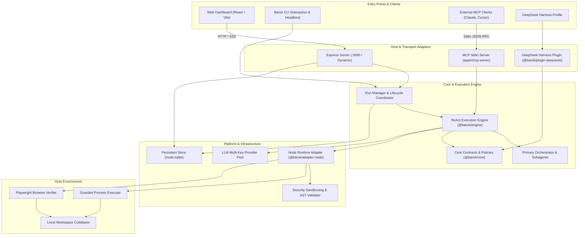
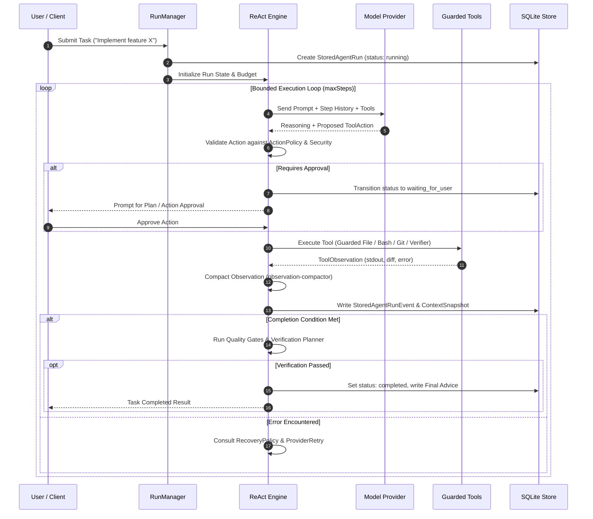
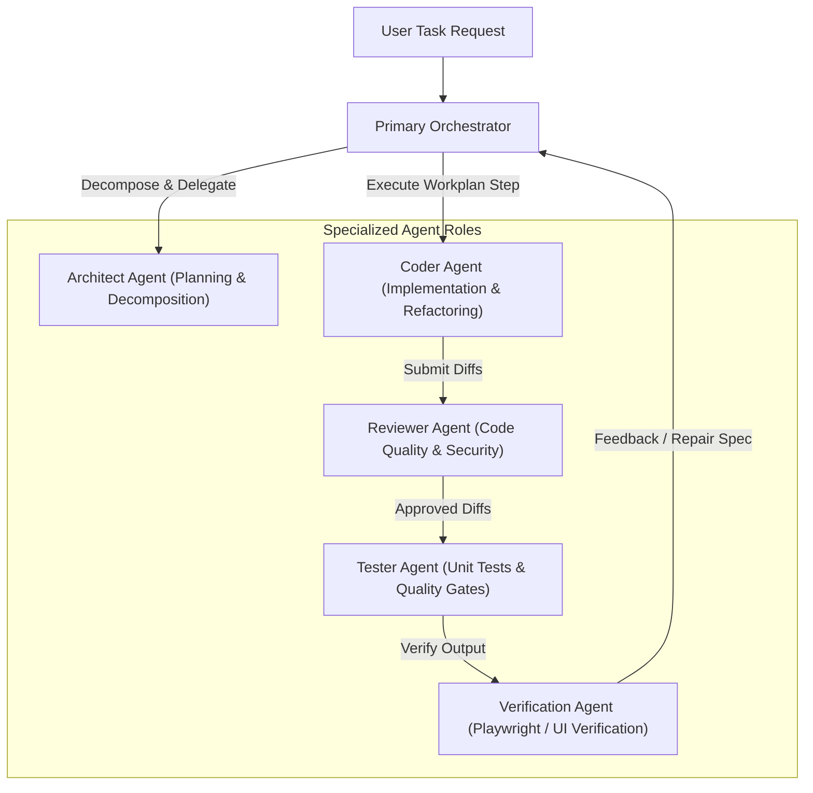
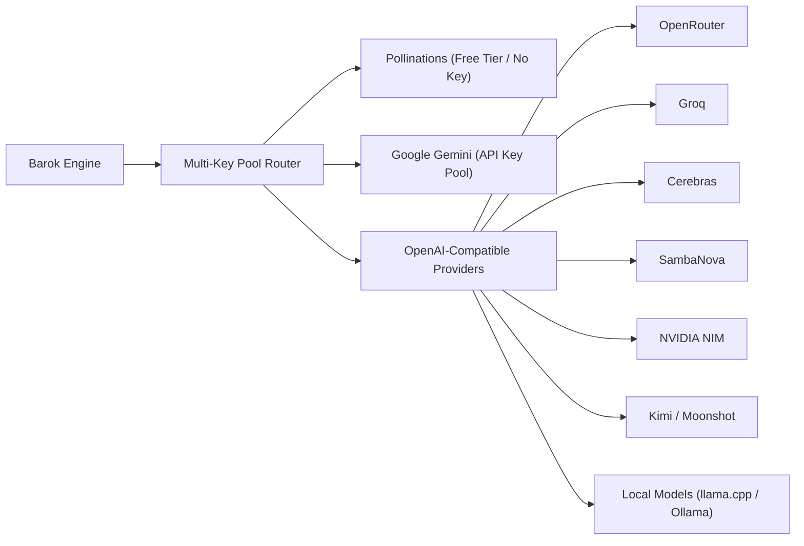
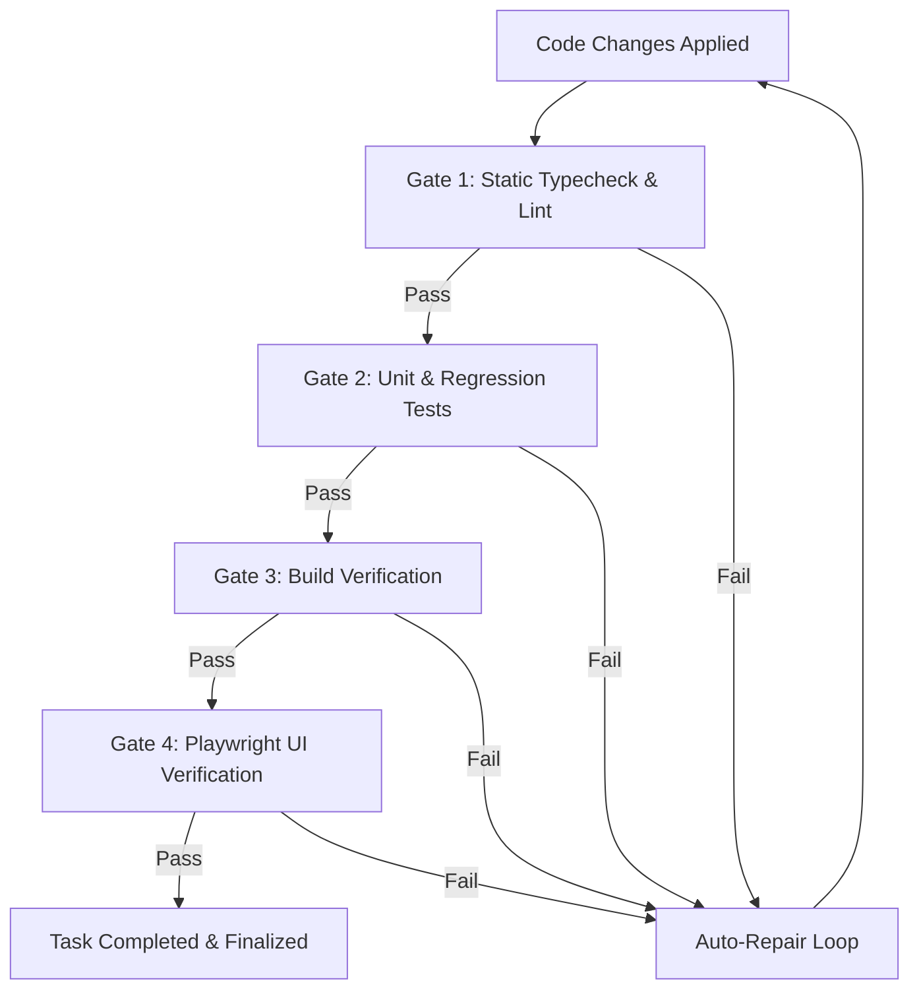

# Barok System Documentation

## 1. Executive Overview & System Architecture

**Barok** is an autonomous, full-stack AI software development system designed for complex software engineering workflows. It provides two operational modes:

1. **Standalone AI Development Workspace:** A local autonomous engineering platform offering an interactive Web Dashboard (React + Tailwind + Vite), an Express REST/SSE backend, an interactive Command-Line Interface (CLI), and a Model Context Protocol (MCP) server. It manages the full lifecycle of software development: requirements analysis, task planning, guarded workspace file modification, command execution, Playwright browser/UI verification, automated error recovery, and persistent session checkpoints.
2. **DeepSeek Harness Plugin (`@barok/plugin-deepseek`):** A lightweight, cordis-compatible plugin integrating Barok's deterministic task classification, path normalization, and coding workflow guidance into the DeepSeek Harness ecosystem without starting a secondary agent loop.

### High-Level Architecture Diagram



---

## 2. Repository & Monorepo Structure

The Barok repository is structured as a TypeScript monorepo with dedicated extracted packages in `packages/`, standalone applications in `apps/`, the core legacy application in `src/`, and the frontend dashboard in `ui/`.

```
Barok/
├── apps/
│   └── mcp-server/              # Standalone stdio MCP server application
├── barok_move_todo/             # Monorepo migration tracking and specifications
│   ├── TODO.md                  # Master extraction checklist and status
│   ├── todo_1.md                # Detailed component extraction punchlist
│   ├── USER_GUIDE_TODO.md       # Operational workflow and publishing steps
│   ├── FOLDER_STRUCTURE.md      # Target package directory hierarchy
│   └── REPOSITORY_INVENTORY.md  # Detailed inventory of modules and paths
├── docs/                        # Specialized architectural documentation and feature guides
├── packages/                    # Extracted monorepo packages
│   ├── core/                    # Host-neutral pure logic, contracts, and helpers
│   ├── engine/                  # ReAct loop runtime contracts, policies, and algorithms
│   ├── adapter-node/            # Node.js concrete filesystem, process, and crypto adapters
│   ├── adapter-mcp/             # MCP tool definitions and protocol adapters
│   └── plugin-deepseek/         # DeepSeek Harness integration bundle
├── public/                      # Static assets served by Express
├── src/                         # Application source tree (standalone engine and backend)
│   ├── agents/                  # Multi-agent coordination, subagents, and roles
│   ├── cli/                     # CLI command processors and terminal runner
│   ├── coder/                   # Task analysis, diff application, and prompts
│   ├── config/                  # Execution profiles, settings, and provider configs
│   ├── contracts/               # Shared TypeScript type definitions
│   ├── di/                      # Dependency injection containers and runtime ports
│   ├── evals/                   # Quality gates, evaluations, and metrics
│   ├── logging/                 # Structured logging, run tracing, HTTP error middleware
│   ├── mcp/                     # MCP protocol handlers and tool implementations
│   ├── orchestration/           # Primary orchestrator and subtask management
│   ├── persistence/             # SQLite database layer, checkpoints, restore points
│   ├── pollinations/            # Pollinations API client and fallback logic
│   ├── react/                   # Standalone ReAct engine loop and run manager
│   ├── repo/                    # AST analysis, file tree indexing, symbol lookup
│   ├── routes/                  # Express REST/SSE API route definitions
│   ├── runtime/                 # Execution environment and safety validation
│   ├── security/                # AST command validation, path sandboxing, rate limits
│   ├── tasks/                   # Task classification and workplan management
│   ├── tools/                   # Workspace tool implementations (file, bash, git, browser)
│   ├── types/                   # Zod schemas and runtime validation types
│   ├── utils/                   # Token counters, cost trackers, string utilities
│   ├── validation/              # Pydantic/Zod-style argument validators
│   └── workspace/               # Workspace diff tracking, fingerprinting, path guards
├── storage/                     # SQLite database files, restore points, server instances
├── system_documentation/        # Master system documentation
├── ui/                          # Frontend React SPA (Vite + Tailwind CSS)
│   ├── src/
│   │   ├── components/          # React components (Chat, Diff, Explorer, Monitors)
│   │   ├── hooks/               # Custom hooks for SSE streams and API polling
│   │   ├── utils/               # Formatting, styling, and client helpers
│   │   ├── App.tsx              # Main dashboard application container
│   │   ├── StructureExplorer.tsx# Interactive file system tree and code viewer
│   │   └── modelOptions.ts      # LLM provider and model catalog
│   └── vite.config.ts           # Vite build configuration
├── server.ts                    # Main backend server entry point (Express)
├── package.json                 # Monorepo root dependencies and build scripts
└── tsconfig.json                # Root TypeScript compiler configuration
```

### Monorepo Packages Overview

| Package | Scope & Responsibilities | Key Dependencies |
| :--- | :--- | :--- |
| **`@barok/core`** | Host-neutral contracts, deterministic task classification (`classifyTask`), path normalization (`normalizeFilePaths`), token math, sanitized analysis views, error redaction. | Zero runtime dependencies. No Node, Express, or Harness imports. |
| **`@barok/engine`** | ReAct loop contracts, context snapshot management, bounded child dispatch, observation compaction, pricing & budget management, safe planner response parsing, execution pacing, recovery rules, quality gates. | `@barok/core`. No host filesystem or network dependencies. |
| **`@barok/adapter-node`** | Concrete Node.js platform implementation: guarded process execution, path canonicalization across Windows/POSIX, Playwright discovery, SHA-256 providers, dirty-worktree scanning. | `@barok/core`, `@barok/engine`, Node.js native APIs (`node:fs`, `node:child_process`, `node:crypto`). |
| **`@barok/adapter-mcp`** | Tool definitions, request schema validation, and transport adapters for the Model Context Protocol. | `@barok/core`, `@modelcontextprotocol/sdk`. |
| **`@barok/plugin-deepseek`**| Cordis-compatible plugin bundle for DeepSeek Harness exposing Barok Core task classification and path normalization tools, alongside prompt guidance. | `@barok/core`. |

---

## 3. Core ReAct Engine & Execution Model

Barok's execution loop is built on the **ReAct (Reason + Act)** paradigm: alternating between structured LLM reasoning, executing approved tool actions against the target workspace, compacting the resulting observations, and updating the task state.

### The ReAct Execution Cycle



### Run Lifecycle States

Runs transition through deterministic states defined in `packages/engine/src/run-lifecycle.ts` and `src/persistence/sqliteStore.ts`:

- **`running`**: Actively executing steps, generating reasoning, or running tools.
- **`waiting_for_user`**: Paused waiting for the user to approve a plan, authorize a sensitive tool execution (e.g., shell command), or answer a clarifying question.
- **`waiting_for_provider`**: Temporarily backoff-delayed due to rate limiting (HTTP 429/503), key cooldowns, or network retry pacing.
- **`completed`**: Successfully satisfied all task goals, validated by quality gates.
- **`failed`**: Halted due to unrecoverable errors, exhausted retries, or policy violations.
- **`stopped` / `interrupted`**: Gracefully paused or cancelled by the user.
- **`killed`**: Terminated forcefully upon server shutdown or timeout.

### Checkpoints & Continuation Handoff

Every state transition produces a `StoredAgentContextSnapshot` stored in the SQLite database. If a run is interrupted by network failure, user pause, or server restart:
1. The **Run Manager** retrieves the latest context snapshot, event sequence, and workspace fingerprint.
2. The **Continuation Handoff** module (`packages/engine/src/checkpoint-handoff.ts`) reconstructs the working memory, todo list, completed step history, and active workplan.
3. The engine resumes execution from the exact step without re-running completed mutations.

---

## 4. Tool System & Security Sandboxing

Barok provides a suite of developer tools designed for repository inspection, modification, and verification while enforcing strict safety boundaries.

### Workspace Developer Tools

| Tool Category | Tools | Capabilities & Guardrails |
| :--- | :--- | :--- |
| **File Operations** | `read_file`, `write_file`, `edit_file`, `patch_file` | Precise slice viewing, full-file writing, chunk replacement, patch verification. Path traversal protection ensures all paths resolve strictly within the designated workspace root. |
| **Discovery** | `glob_files`, `grep_search`, `list_directory` | Regex and glob searching across repository files, respecting `.gitignore` and excluding binary/cache directories (`node_modules/`, `.git/`, `dist/`). |
| **Command Execution**| `run_bash`, `run_powershell`, `guarded_command` | Spawns sandboxed processes with strict timeout limits (default 30s). Blocked command patterns (destructive system mutations) are rejected via AST analysis. |
| **Git Operations** | `git_status`, `git_diff`, `git_commit`, `git_log` | Inspects working tree changes, unstaged/staged diffs, branch states, and generates commit snapshots for rollback. |
| **Verification & Web** | `verify_app`, `playwright_test`, `inspect_browser` | Runs Playwright tests against browser web apps, verifies build artifacts, captures runtime console errors, and feeds diagnostic logs back to the engine. |

### Security Sandboxing

The security subsystem (`src/security/` and `packages/adapter-node/src/process/`) enforces four layers of defense:

1. **Path Sandboxing:** Canonicalizes all file paths and verifies symlinks. Any attempt to traverse above the workspace root (e.g., `../../Windows/System32`) or access forbidden directories (e.g., `.git/hooks`) is rejected with a security violation.
2. **Command AST Validation:** Analyzes command strings before shell execution. Disallows high-risk commands (e.g., recursive root deletions, format commands, raw socket listeners) and enforces non-interactive execution flags.
3. **Network Security & Rate Limiting:** Built-in CORS filtering, local LAN binding checks (`isLanBinding`), and token-bucket API rate limiting (`apiRateLimit.ts`) on all Express HTTP/SSE endpoints.
4. **Data Redaction:** Redacts API keys, credentials, JWTs, and sensitive environmental tokens from logs, event streams, and error messages before persistence or display.

---

## 5. Multi-Agent Orchestration & Subagent Hierarchy

Barok supports decomposing large engineering tasks across a hierarchy of specialized agents:



- **Primary Orchestrator (`src/orchestration/`):** Manages the root workplan, creates subtasks, controls budget distribution across subagents, and aggregates progress.
- **Bounded Child Runs:** Child agents run in isolated sub-contexts with bounded step budgets to prevent cascading loops.
- **Structured Decision Protocol:** Agents communicate via structured JSON schemas (`agent-decision.ts`) ensuring machine-verifiable task completions.

---

## 6. LLM Providers & Resilience Architecture

Barok supports a diverse set of local and cloud LLM providers, ensuring high availability, rate-limit resilience, and cost optimization.

### Supported Providers



### Multi-Key Pooling & Cooldown Policies

To withstand aggressive API rate limits on cloud providers:
- **Key Rotation Pools:** Multiple API keys can be configured per provider. Barok rotates through keys round-robin.
- **Automatic Cooldown:** If a key receives an HTTP `429 Too Many Requests` or `503 Service Unavailable`, it is placed into an exponential cooldown pool while healthy keys continue serving requests.
- **Model Escalation:** If a smaller model fails repeatedly or struggles with complex reasoning during verification, the engine can escalate to a more capable tier (e.g., escalating from a lightweight coding model to a deep reasoning model).

---

## 7. Persistence & Storage Subsystem

Barok utilizes Node's native SQLite implementation (`DatabaseSync` from `node:sqlite`) for robust, zero-configuration local persistence located at `storage/react-engine.sqlite`.

### Core Database Entities

| Entity / Table | Purpose & Schema Details |
| :--- | :--- |
| **`coder_threads`** | Persistent conversational sessions holding user messages, assistant responses, and thread metadata. |
| **`agent_runs`** | Individual agent execution runs, tracking status, model, task description, step count, and execution duration. |
| **`agent_run_events`** | Event-sourced append-only log of every thought, tool call, tool observation, and checkpoint occurring during a run. |
| **`context_snapshots`** | Serialized state dumps (todos, workplans, active memory) for crash recovery and continuation handoffs. |
| **`restore_points`** | Workspace file change snapshots enabling one-click rollbacks of agent edits. |
| **`runtime_settings`** | User settings, provider configurations, key pools, and execution profile overrides. |
| **`server_instances`** | Process registry (`storage/server-instance-<port>.json`) enabling graceful replacement and stale PID termination upon server restart. |

---

## 8. User Interfaces & Entry Points

### 1. Web Dashboard (`ui/`)
A modern single-page application built with React, Vite, and Tailwind CSS:
- **Coder Chat:** Live conversational interface displaying formatted Markdown, syntax-highlighted code blocks, thought processes, and real-time tool execution progress.
- **Structure Explorer (`StructureExplorer.tsx`):** Interactive file-tree browser with code viewer, symbol navigation, and git change tracking.
- **Workplan & Approval Drawer:** Visual step-by-step plan viewer allowing users to approve, reject, or modify agent actions before execution.
- **Provider & Model Settings:** Dashboard for managing API keys, testing provider latency, toggling model parameters (temperature, maxTokens, topP), and selecting execution profiles.

### 2. REST & SSE API (`server.ts` & `src/routes/`)
- `/api/coder`: Conversational endpoints (threads, messages, streaming).
- `/api/runs`: Run lifecycle control (start, pause, resume, cancel, event streaming via SSE).
- `/api/workplans`: Workplan generation, step approvals, and progress updates.
- `/api/workspace`: File operations, directory tree querying, git status/diff, and restore points.
- `/api/providers`: Provider status, model listings, key health metrics, and latency checks.
- `/api/settings`: Execution profiles and runtime configuration.
- `/api/system`: System health, memory consumption, Node.js version, and process uptime.

### 3. Barok CLI (`src/cli/`)
Command-line interface for running tasks directly from the terminal, supporting interactive conversational mode, headless automated scripts, and CI/CD quality gate enforcement:
```powershell
# Start Barok CLI
npm run cli

# Run headless task
npm run cli -- --task "Fix the build error in src/index.ts" --profile thorough
```

### 4. Model Context Protocol (MCP) (`apps/mcp-server/`)
Implements an MCP-compliant server over stdio transport. Enables external AI tools (such as Claude Desktop or Cursor) to leverage Barok's workspace tools, task classifiers, and repository analysis functions.

### 5. DeepSeek Harness Plugin (`packages/plugin-deepseek/`)
Provides task classification (`barok_classify_task`) and file-path normalization (`barok_normalize_file_paths`) tools, plus coding workflow guidance to DeepSeek Harness profiles.

---

## 9. Verification, Quality Gates & Testing

Barok incorporates multi-level verification to validate changes before completing tasks:



- **Typecheck & Linting:** Evaluates TypeScript types (`tsc --noEmit`) to catch type errors immediately.
- **Unit Suite:** Runs Jest test suites with isolated OS-temp SQLite databases to verify regressions.
- **Playwright Verifier:** Tests generated frontend web applications by loading them in a headless browser, checking for runtime console errors, failed network requests, and visual layout issues.
- **Auto-Repair Loop:** When verification gates fail, the engine generates an `AppRepairSpec`, analyzes the failure logs, and automatically plans a targeted repair turn.

---

## 10. System Configuration & Execution Profiles

Execution profiles (`src/config/executionProfiles.ts`) tune the agent's behavior based on task requirements:

| Profile | Max Steps | Max Tokens | Verification Rigor | Best Suited For |
| :--- | :--- | :--- | :--- | :--- |
| **`fast`** | 10 | 4,096 | Minimal / Smoke only | Simple queries, quick edits, script modifications. |
| **`balanced`** | 25 | 8,192 | Standard unit tests | General feature development and bug fixes. |
| **`thorough`** | 50 | 16,384 | Full test suite + Playwright | Architectural refactors and complex multi-file features. |
| **`cost-optimized`** | 15 | 4,096 | Static analysis | Low-cost runs using free or discounted model endpoints. |

### Environment Variables (`.env`)

Key configuration variables include:
- `PORT`: HTTP server port (default: `3000`).
- `WORKSPACE_ROOT`: Target project path for agent operations.
- `POLLINATIONS_API_KEY`: Optional key for Pollinations tiering.
- `GEMINI_API_KEYS`: Comma-separated Google AI Studio keys for rotation.
- `OPENROUTER_API_KEYS`: Comma-separated OpenRouter keys.
- `GROQ_API_KEYS`, `CEREBRAS_API_KEYS`, `SAMBANOVA_API_KEYS`: High-throughput inference keys.
- `NVIDIA_API_KEYS`: NVIDIA NIM endpoint keys.
- `LOCAL_OPENAI_ENDPOINT`: URL for local models (e.g. `http://127.0.0.1:8080/v1`).
- `LOG_LEVEL`: Logging verbosity (`debug`, `info`, `warn`, `error`).

---

## 11. Migration State & Package Decoupling

Barok is actively undergoing extraction into standalone modular packages (tracked in [`barok_move_todo/TODO.md`](../../barok_move_todo/TODO.md)):

```
Monorepo Extraction Progress:
[=====================================>........] ~82% Complete
```

- **Completed Extractions:**
  - `@barok/core`: Fully decoupled, pure logic, zero dependencies.
  - `@barok/adapter-node`: Guards, path logic, process execution, and fingerprinting extracted.
  - `@barok/adapter-mcp`: Tool definitions and MCP protocol handlers extracted.
  - `@barok/plugin-deepseek`: Harness plugin bundle built and verified locally.
  - `@barok/engine`: Policy rules, checkpoints, budgeting, and state contracts extracted.
  - **Version Alignment:** Root application and all monorepo packages are versioned at `0.0.1-experimental`.
- **Current / Remaining Work:**
  - Extracting the remaining ReAct execution loop from `src/react/engine.ts` into `@barok/engine`.
  - Rewiring the Express server routes and CLI to consume the extracted packages directly.
  - Establishing end-to-end parity across web, CLI, and MCP interfaces.
  - Publishing private scoped npm packages under `@barok` once scope authentication is configured.

